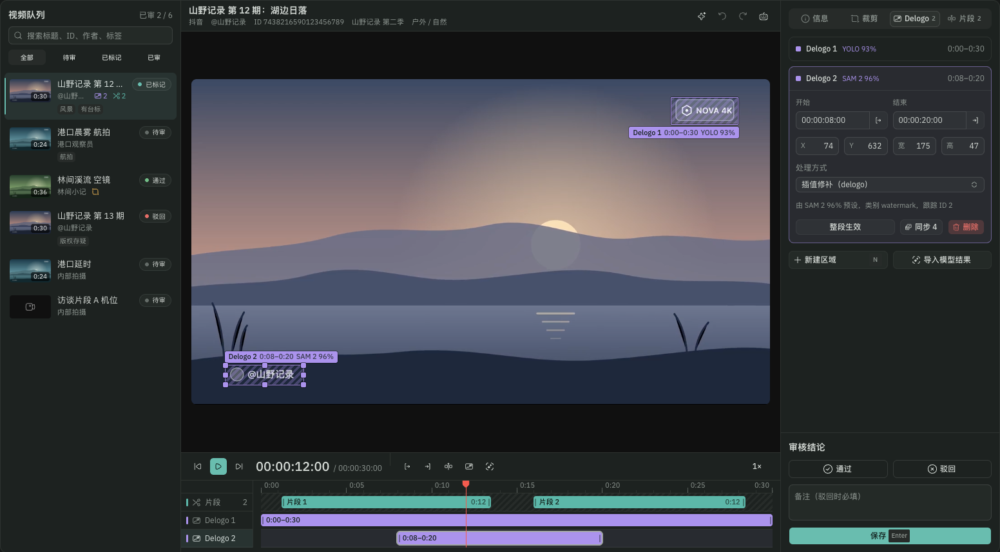

# 审片台 video-review-ui

[](https://github.com/zkldwxz/video-review-ui/actions/workflows/ci.yml) [](LICENSE)

批量视频审核的前端组件和工作台模板：在画面上框选裁剪区域和 Delogo（去台标 / 水印）区域，在时间轴上切出要保留的片段，给出通过或驳回的结论，最后导出带像素坐标的处理任务交给后端转码。



## 功能

- **多视频队列**：搜索标题、视频 ID、作者、标签，按审核状态筛选；↑ / ↓ 切换视频
- **裁剪**：拖动、缩放，可锁定 16:9、9:16、1:1、4:3 等比例，可一键同步到同分辨率的其他视频
- **Delogo**：多个区域，可自由缩放，每个区域有独立的生效时间段；处理方式可选插值修补或模糊
- **片段剪切**：入点 / 出点、在播放头处切开，时间轴上直接拖动两端
- **模型预设**：粘贴或通过 API 传入 YOLO（标签文本 / Ultralytics JSON）、SAM / SAM 2（bbox、COCO RLE）的结果，逐帧的框自动合并成带时间段的 Delogo 区域
- **视频信息**：可重命名标题、打标签，展示来源平台、作者、播放 / 点赞 / 评论等数据和自定义字段
- **播放**：倍速 0.5–3×，长按画面或按住 → 2 倍速快进；加载时只在画面底边显示一根细线，不遮挡画面
- **快捷键**：默认键位覆盖播放、标记、撤销、保存，可在界面里自定义；撤销 / 重做带提示
- **深色 / 浅色主题**：护眼配色，画面周围保持无色中性灰（见 [DESIGN.md](DESIGN.md)）

## 快速开始

需要 Node 22+ 和 pnpm 10。

```bash
pnpm install
pnpm dev
```

打开 http://localhost:5173 。demo 自带三段用 ffmpeg 生成的示例视频（`public/samples/`）。

可选：
- **B 站测试视频**：页面顶部可以按 BV 号加载 B 站视频。B 站接口和 CDN 有跨域和防盗链校验，需要先安装 [请求头助手插件](extensions/header-bridge/README.md)。
- **AI 改写标题**：在项目根目录的 `.env.local` 写入 `ANTHROPIC_API_KEY=...` 后重启 `pnpm dev`。这个接口只在开发服务器里运行（`server/`）。

## 接入到自己的系统

审核组件在 [`src/review-kit/`](src/review-kit/README.md)：

```tsx
<VideoReviewer
  videos={videos}
  tagOptions={['风景', '需二审']}
  onSave={async (task) => api.submit(task)}
/>
```

`onSave` 收到的 `ReviewTask` 里，裁剪、Delogo 坐标都已换算成像素，片段为秒。完整的字段、模型适配器用法和默认快捷键见 [src/review-kit/README.md](src/review-kit/README.md)。

## 目录

```
src/review-kit/        审核组件：core 纯逻辑 / adapters 模型适配 / react 组件
src/demo/              设计规范页和接入示例
src/components/ui/     shadcn/ui 组件（Radix + Mira 预设）
extensions/header-bridge/  Chrome MV3 插件：改写 Referer / Origin / UA
server/                开发服务器里的 demo 接口（AI 标题）
DESIGN.md              设计规范：颜色、字体、密度、动效、图标
```

## 开发

```bash
pnpm lint        # oxlint
pnpm typecheck   # tsc
pnpm test        # vitest
pnpm build
```

技术栈：Vite 8、React 19、TypeScript 7、Tailwind CSS v4、shadcn/ui、Hugeicons。

每次推送和 PR 都会在 GitHub Actions 上跑同样的检查（`.github/workflows/ci.yml`）。

依赖安全：CI 里的 Action 固定到 commit SHA，权限只读；`pnpm-workspace.yaml` 设置了 `minimumReleaseAge`（不安装发布不足一天的版本）和 `strictDepBuilds`（依赖的安装脚本默认不执行）。

## 说明

请求头助手插件用于在审核工具里播放你有权访问的视频。请遵守视频平台的服务条款和内容的版权要求。

## 许可证

[MIT](LICENSE)
